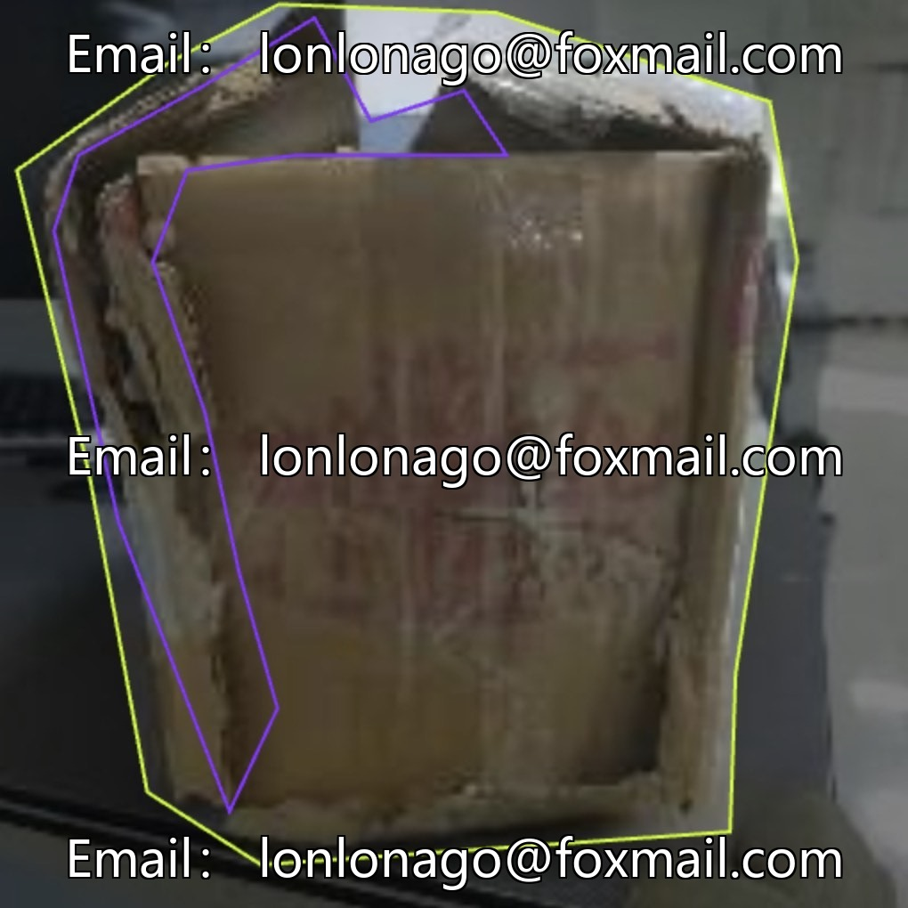
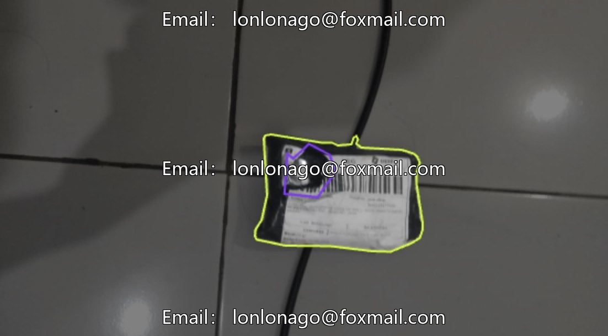
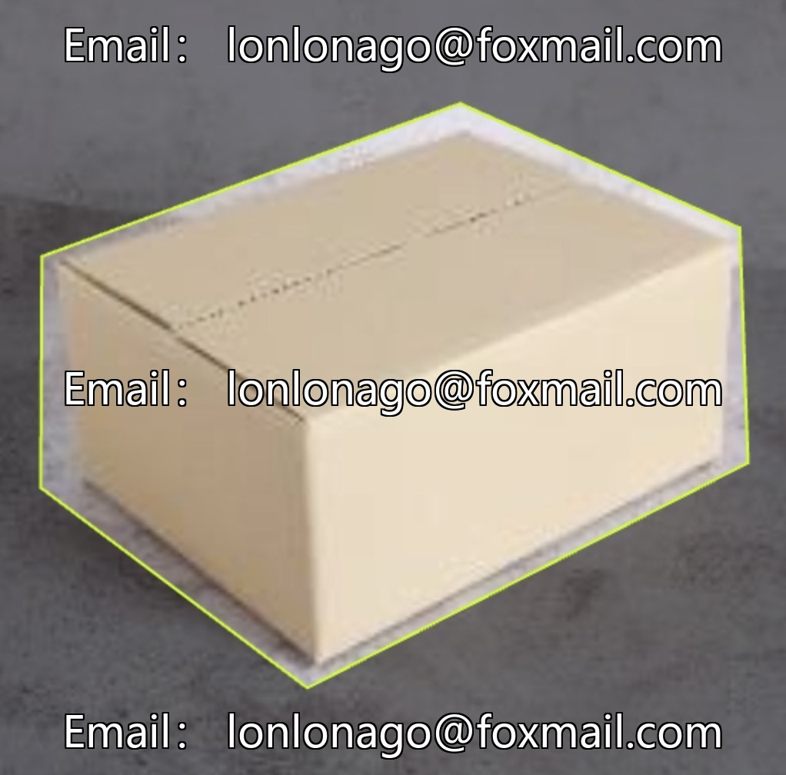
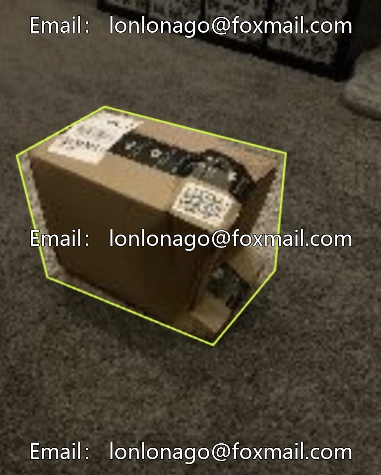
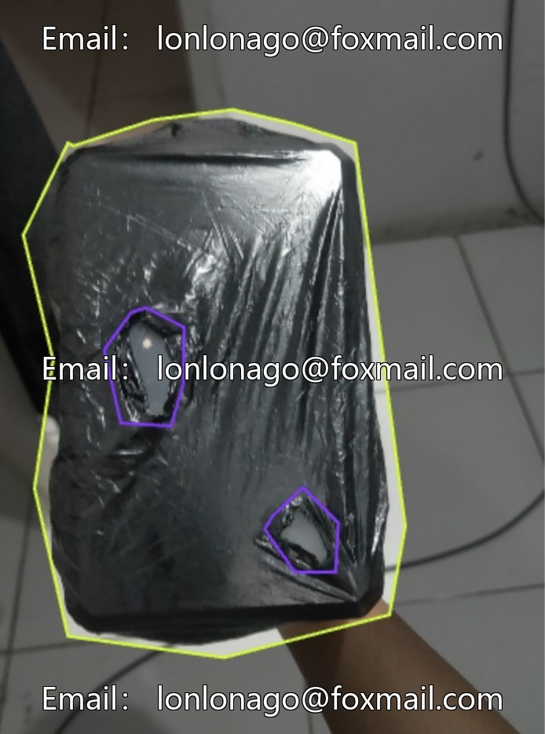
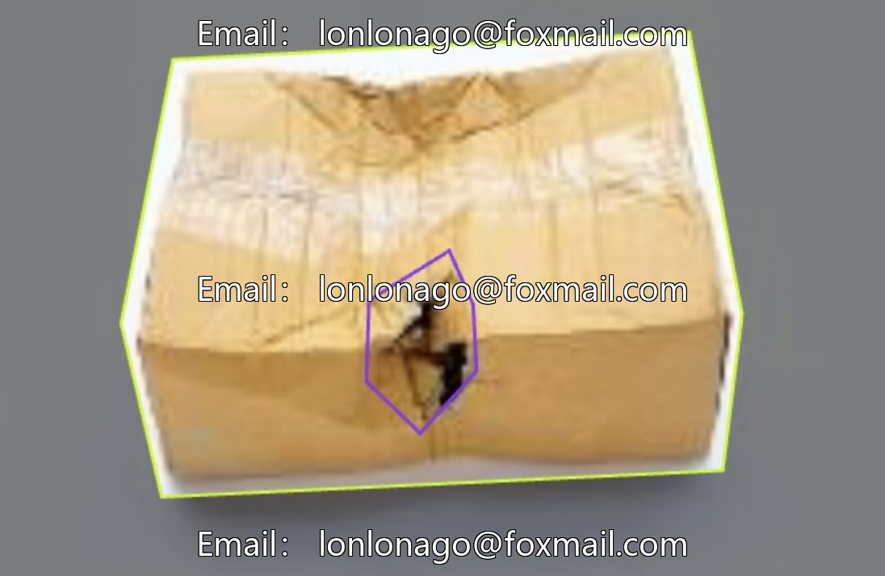

# Kraft paper box damage detection dataset

## Body

Paper box damage detection dataset intelligent AI paper box damage detection dataset, including 400 high-quality labeled images, 2 classes core objectives: package, damaged area. Data format supports voc+coco+yolo, suitable for logistics and warehousing, sorting quality monitoring, end delivery evidence collection, warehouse digital management and other scenarios.

The dataset covers various environments and lighting conditions, including tearing, squeezing, etc., and supports the training of mainstream target detection frameworks to enhance the generalization ability of the model.

Virtual materials, once sold, are non-refundable.
Interested friends, click "I want" to proceed.

## Images

## Payment

Here is a pay link on Stripe ( https://buy.stripe.com/3cs8yP7sY87d0vu9AB ). Please contact me lonlonago@foxmail.com after funding $89, and I will send you a complete data files , thank you!

